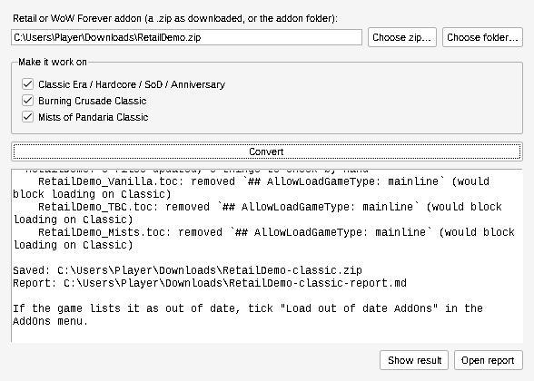

# WoW Classic Addon Converter

Turn an addon made for **retail World of Warcraft** or **WoW Forever** into one that runs on **WoW Classic**.
It works for Classic Era, Hardcore, Season of Discovery, Anniversary, TBC Classic and Mists of Pandaria Classic.

**Yes, it works with WoW Forever addons.** Forever addons are written with the same modern code as
retail addons, and that's exactly what the converter translates for Classic. It recognizes Forever's
own addon files automatically, so there's nothing extra to do.

**[⬇ Download WoWClassicConverter.exe](https://github.com/Photronix2020/Wow-classic-converter/releases/latest/download/WoWClassicConverter.exe)**
(Windows, free, nothing to install)



## How to use it

### 1. Get the retail or Forever addon

Download the addon you want from CurseForge, Wago, WoWInterface, GitHub or wherever it lives.
Both retail and WoW Forever versions work.
Keep the **.zip file** as it downloaded; you don't need to unzip it.

### 2. Convert it

1. Double-click **WoWClassicConverter.exe**.
   - The first time, Windows may show *"Windows protected your PC"*. Click **More info**, then **Run anyway**.
     See [Is it safe?](#is-it-safe) for why this happens.
2. Click **Choose zip…** and pick the addon zip from step 1.
   If you have an addon folder instead of a zip, use **Choose folder…**.
3. Tick the Classic versions you play. Leaving all three ticked is fine.
4. Click **Convert**.

A new file appears next to the original, named after it with **-classic** on the end.
For example, `CoolAddon.zip` becomes `CoolAddon-classic.zip`.
Click **Show result** to open the folder it's in.

### 3. Install it in Classic

1. Open your Classic AddOns folder. If you're not sure where it is, open the Battle.net app, pick the
   Classic game, click the gear next to **Play**, and choose **Show in Explorer**. Then open `Interface`,
   then `AddOns`. Create those folders if they don't exist yet.

   | You play | The AddOns folder is in |
   |---|---|
   | Classic Era, Hardcore, Season of Discovery | `World of Warcraft\_classic_era_\Interface\AddOns` |
   | Anniversary realms | `World of Warcraft\_anniversary_\Interface\AddOns` |
   | Mists of Pandaria Classic | `World of Warcraft\_classic_\Interface\AddOns` |

2. Double-click the **-classic.zip** file to open it. Inside are one or more folders.
   Drag those folders straight into **AddOns**.

   > ⚠️ Don't use "Extract All" with its default settings. It puts everything inside an extra folder
   > (`AddOns\CoolAddon-classic\CoolAddon`), and the game won't find it. The finished layout must be
   > `AddOns\CoolAddon\CoolAddon.toc`.

3. Start the game. On the character screen, click **AddOns** at the bottom left and check the addon is
   ticked. If it says **Out of date**, tick **Load out of date AddOns** at the top.

That's it. To remove a converted addon, delete its folder from AddOns.

## What to expect

The converter fixes the things that usually stop retail addons loading on Classic: renamed and
reorganized game functions, and newer game events Classic doesn't know about. How well a converted
addon works depends on what it does.

| | Kind of addon | Examples |
|---|---|---|
| ✅ Usually works | Uses features Classic also has | Bag and inventory tools, tooltip info, chat tweaks, cooldown and buff trackers, unit frame tweaks, small UI changes |
| ⚠️ Partly works | Mostly general, with some retail-only features | An addon that also shows Mythic+ scores: the rest works, that part stays empty |
| ❌ Won't be useful | Built around a system Classic doesn't have | Mythic+ tools, Delves, garrisons, the modern talent tree, transmog collections |

**Forever addons** are often the easiest to convert. Forever is set in the original Azeroth like
Classic, so its addons tend to rely less on retail-only systems. If an addon offers both a retail and a
Forever version, the converter uses the Forever one.

WoW Forever launches on November 4, 2026. Forever support was built and tested against addons released
for the Forever beta. If something in the final release behaves differently, please
[open an issue](https://github.com/Photronix2020/Wow-classic-converter/issues).

Next to the converted zip is a **report** (`-classic-report.md`, open it with **Open report**). It lists anything
the converter found that Classic probably doesn't support, so you can tell in advance which features won't work.

**Check first whether the addon already has a Classic version.** Many popular addons, such as Details!,
WeakAuras, Questie and Bagnon, release official Classic versions. Those always beat a converted copy, so use the
converter for addons that don't.

## Problems?

**The game shows a Lua error from the addon.**
Some part of the addon uses something Classic doesn't have. Check the report for that file name.
The addon may still be mostly usable. If it isn't, that addon can't be converted automatically.

**The addon doesn't appear in the AddOns list.**
It's almost always the extra-folder problem from step 3. Open the AddOns folder and make sure you see
`CoolAddon\CoolAddon.toc`, not `CoolAddon-classic\CoolAddon\CoolAddon.toc`.

**It says "Out of date".**
Tick **Load out of date AddOns** in the AddOns menu. This happens when a game patch is newer than the
converter's version list. It's harmless.

**"No addon found" when converting.**
The zip or folder you picked doesn't contain an addon (a folder with a `.toc` file inside).
Make sure you picked the addon itself and not, say, a zip of several unrelated things.

**Can I share addons I've converted?**
Converting for your own use is fine. Before posting a converted copy of someone else's addon, check its
license or ask the author.

### Is it safe?

Windows warns about the exe because it isn't code-signed, which costs money every year, not because
anything is wrong with it. The exe is built automatically by GitHub from the source code in this
repository (see [the build script](.github/workflows/build.yml)), so you can check exactly what it does.
It never connects to the internet. It reads the addon you choose and writes a new zip next to it.
Your original addon isn't changed.

---

# For developers

Everything below is technical detail. You don't need it to use the converter.

## Command line

The exe also works from a terminal (`WoWClassicConverter.exe MyAddon.zip -o out.zip`), or run
from source with Python 3.9+ and no other dependencies.

### Usage

```sh
# a folder (the addon folder itself, a folder of addons, or a GitHub checkout)
python3 -m wowconv path/to/MyAddon -o out/

# a zip as downloaded from CurseForge / Wago / GitHub, straight to a zip
python3 -m wowconv MyAddon-1.2.zip -o MyAddon-classic.zip

# only Classic Era, with your client's exact interface number
python3 -m wowconv MyAddon -o out/ -t vanilla --interface vanilla=11508
```

Copy the folder(s) in the output to `World of Warcraft/_classic_era_/Interface/AddOns/`
(or `_classic_` / `_anniversary_` for the other Classic clients) and read
`CONVERSION_REPORT.md`.

| Option | Meaning |
|---|---|
| `-t, --target` | `vanilla` (Classic Era, Hardcore, SoD, Anniversary), `tbc`, `mists`. Repeatable; default is all three. |
| `--interface TARGET=N` | TOC `## Interface` number. Defaults are in `wowconv/apidb.py`; check yours in game with `/dump select(4, GetBuildInfo())`. |
| `--rewrite-libs` | Also rewrite embedded libraries under `Libs/`. Off by default since Ace3, LibStub and similar already support Classic. |

## What it does

1. **TOC files.** Writes `<Addon>_Vanilla.toc`, `_TBC.toc`, `_Mists.toc` from the
   retail TOC with the right `## Interface`, and drops `## AllowLoadGameType`
   lines that would stop it loading. If the addon already ships a Classic TOC,
   that one is kept, since the author already supports that client.
2. **API shim.** Adds `ClassicCompat.lua` (loaded first) with versions of modern
   APIs built on the older ones Classic still has, and points the addon's code at
   them. Covered:
   - `C_Spell` (`GetSpellInfo`, `GetSpellCooldown`, `GetSpellCharges`, `IsSpellInRange`, …, returning the retail table shapes)
   - `C_Item`, `C_Container`, `C_AddOns`, `C_CVar`
   - `C_UnitAuras` (`GetAuraDataByIndex`, `GetBuffDataByIndex`, `GetPlayerAuraBySpellID`, …, returning `AuraData` tables)
   - `C_Reputation`, `C_QuestLog`, `C_ChatInfo`, `C_ClassColor`
   - `Settings` (canvas categories mapped onto the old Interface Options panel)
   - `TooltipDataProcessor.AddTooltipPostCall` (mapped onto `OnTooltipSetItem/Spell/Unit`)
   - `GetMouseFoci`, plus safe defaults for spec and absorb functions and `issecretvalue`
3. **Events.** Classic clients raise an error when an addon registers an event they
   don't know. Every `obj:RegisterEvent(...)`, `RegisterUnitEvent` and
   `UnregisterEvent` call is routed through a check that skips unknown events.
   This also covers Ace-style `self:RegisterEvent("X")`.
4. **Report.** Lists retail-only features the addon uses that have no Classic
   equivalent (Mythic+, garrisons, talents/traits, transmog collection, Edit Mode,
   retail-only XML templates, …) and anything the shim doesn't cover.

### Safety

- Strings and comments are never modified.
- Nothing leaks to other addons. The shim lives in one uniquely named global,
  `ClassicCompat_<AddonName>`, and doesn't create or change any real API
  globals.
- The real API always wins. Each fill only applies when the client lacks that
  function, so the converted addon still works on retail.
- If a file declares its own local with the same name as an API (for example
  `local Settings = {}`), that name is left alone in that file and noted in the
  report.

## Limits

This isn't magic. It can't create game systems Classic doesn't have.
An addon built around Mythic+, Delves, or the retail talent tree has nothing to
run against. The tool makes the *rest* of the addon load and tells you where
those features are. Interface numbers and the "missing in" data are best-effort
and should be checked against your client. Output from a converted addon should
be tested in game.

## Tests

```sh
python3 -m unittest discover tests
```

The end-to-end tests run the converted sample addon inside a fake Classic client
(`lua5.1` required; those tests are skipped without it). They check that the
original addon crashes there and the converted one runs correctly.

## Building the exe yourself

On Windows with Python 3.12:

```sh
pip install pyinstaller==6.16.0
pyinstaller WoWClassicConverter.spec
```

The result is `dist/WoWClassicConverter.exe`.

## Publishing a new version

Change `__version__` in `wowconv/__init__.py` (for example to `1.0.1`), commit, and push
to `main`. GitHub Actions runs the tests, builds the exe on Windows, and creates release
`v1.0.1` with the exe attached. Pushes that don't change the version only build a test
copy, available under the run's "Artifacts".

The permanent link to the newest exe is
https://github.com/Photronix2020/Wow-classic-converter/releases/latest/download/WoWClassicConverter.exe
